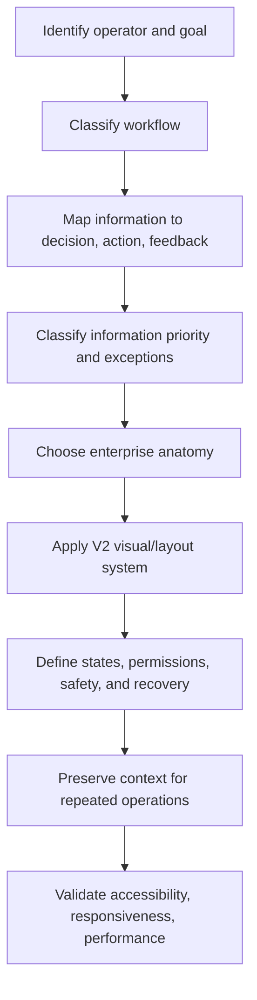

# Dense UI V3

Dense UI is an opinionated, framework-agnostic enterprise visual, layout, interaction, and workflow system. Dense is the normative desktop default for experienced mouse-and-keyboard operators doing repeated, data-heavy work. It means high useful-information density, low unnecessary chrome, strong hierarchy, predictable placement, low interaction cost, and short operational distance. It does not mean tiny type, tiny targets, or zero whitespace.

V2 defines what the interface looks like. V3 defines how it behaves: classify the workflow before choosing anatomy, keep information close to decisions and actions, preserve context across repeated operations, make state/permission/safety boundaries explicit, and provide actionable feedback. Accessibility, safety, auditability, and domain correctness override click minimization.

## Non-negotiable defaults

1. Classify the request as record management, operational workflow, transactional workflow, planning, review/inspection, monitoring, or configuration before choosing screen structure.
2. Start with operator, goal, required information, decision, action, feedback, device, data volume, and failure cost.
3. Classify information as PRIMARY, SECONDARY, STATE, ACTION, METADATA, or EXCEPTION.
4. Apply V2 visual tokens and layout standards from the references; do not invent a new visual mode or rewrite V2 dimensions.
5. Minimize operational distance between intent, information, decision, action, and confirmed result without weakening safety, accessibility, or auditability.
6. Keep frequent/core actions visible; place secondary/rare actions in consistent overflow; make bulk actions appear when selection exists.
7. Distinguish focus, selection, active record, hover, disabled, unavailable, read-only, loading, success, warning, and error.
8. Distinguish domain-state restrictions from permission restrictions and explain the right reason without exposing sensitive data.
9. Prefer undo/reversal when safe; confirm destructive, consequential, broad, external, or irreversible actions with contextual scope and consequences.
10. Preserve filters, view, focus, scroll, active tab, project/warehouse context, and selection where practical during repeated operations.
11. Never silently overwrite stale authoritative data, silently ignore duplicate input, or report failure without a recovery path.
12. Keep dashboards for monitoring and exception detection; keep active operational work in workspaces.

## Agent implementation workflow

1. Identify the operator, goal, workflow class, device, repetition level, data volume, and failure cost.
2. Map the operational path: required information → decision → action → feedback/result.
3. Classify information as PRIMARY / SECONDARY / STATE / ACTION / METADATA / EXCEPTION.
4. Choose the workflow pattern: record management, operational workspace, transaction, planning, inspection, monitoring, or configuration.
5. Choose table, structured list, form, detail, master-detail, planning view, dashboard, drawer, modal, inline edit, or scanner anatomy.
6. Apply the V2 application shell, page header, filters, table/form/detail, status, tokens, responsive, and accessibility standards.
7. Define interaction states, action visibility, permission/state restrictions, destructive safety, and confirmation/undo behavior.
8. Define repeated-operation behavior: focus retention, context preservation, keyboard path, duplicate handling, progress, partial failure, and recovery.
9. Define loading, empty, error, conflict/stale-data, long-running, permission, and audit/history states.
10. Check performance, semantics, contrast, labels, target sizes, zoom/reflow, announcements, and mobile adaptation.
11. Compare relevant official evidence in `references/enterprise-references.md`; label new claims FACT, OBSERVATION, INTERPRETATION, or RULE.
12. Run `references/review-checklist.md` and the operational-efficiency audit in `references/operational-efficiency.md`.

## Reference map

- `references/principles.md`: V2 philosophy plus workflow classification and hierarchy.
- `references/visual-language.md`, `density-tokens.md`, `application-shell.md`, `tables.md`, `forms.md`, `navigation.md`, `statuses.md`: preserved V2 visual/layout system.
- `references/interaction-patterns.md`: component anatomy, state model, focus/selection, action visibility, inline edit, drawers, modals, and keyboard behavior.
- `references/workflow-patterns.md`: CRUD distinction, workflow classes, Operational Distance, next actions, context preservation, search, repeated operations, and workflow trees.
- `references/operational-efficiency.md`: operational distance model, audit procedure, and reporting format.
- `references/permissions-actions.md`: permissions, domain state, hidden/disabled/read-only/unavailable, action hierarchy, destructive safety, undo/reversal, and bulk operations.
- `references/personalization.md`: saved views, column personalization, defaults, mandatory structure, and master-detail.
- `references/history-audit.md`: history/audit anatomy, table vs timeline, before/after diffs, and audit examples.
- `references/feedback-errors.md`: notifications, success, validation, error recovery, concurrency, stale data, long-running operations, and dirty forms.
- `references/warehouse.md`: V2 warehouse guidance plus scanner state and repeated input behavior.
- `references/decision-trees.md`: V2 layout trees plus V3 decision trees.
- `references/enterprise-references.md`: dated official evidence and cross-system matrix.
- `references/anti-patterns.md`: V2 and V3 anti-patterns.
- `references/review-checklist.md`: V2 audit plus V3 workflow review categories.

## Example map

Use V2 examples plus `examples/warehouse-return.md`, `stocktake.md`, `purchase-order-receiving.md`, `bulk-asset-operation.md`, `history-audit.md`, and `master-detail-inspection.md` for V3 workflow patterns. Examples are illustrative, not vendor endorsements or domain requirements.

## Review output

For design or implementation, state operator/goal, workflow class, operational path, information priorities, pattern/anatomy, action and permission rules, safety/recovery, context preservation, V2 tokens, responsive behavior, keyboard/touch behavior, accessibility, performance, and validation checks. For audits, report evidence-backed findings as CRITICAL, HIGH, MEDIUM, or LOW with operational impact.
