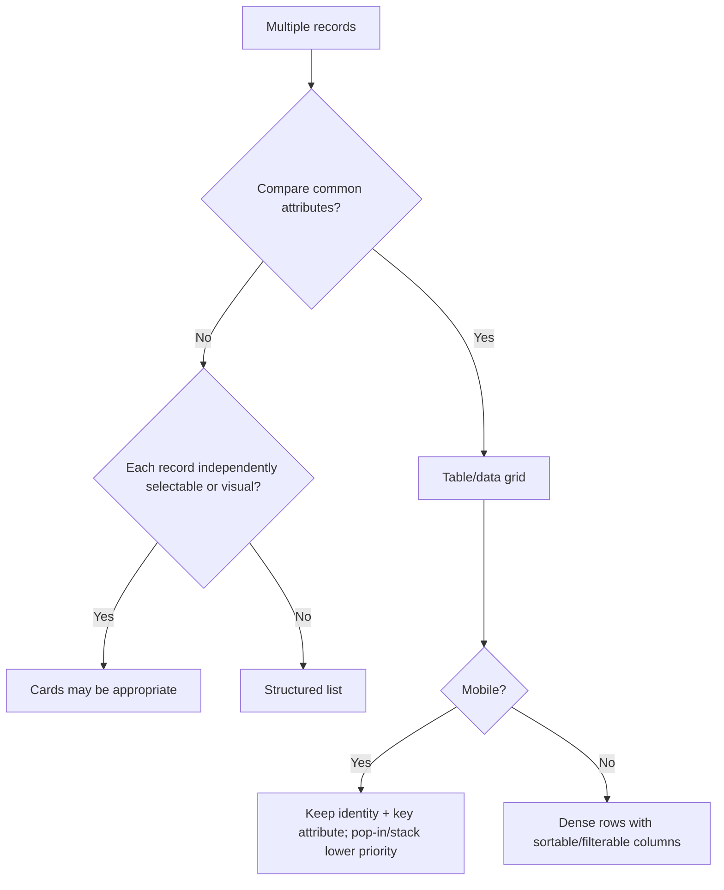
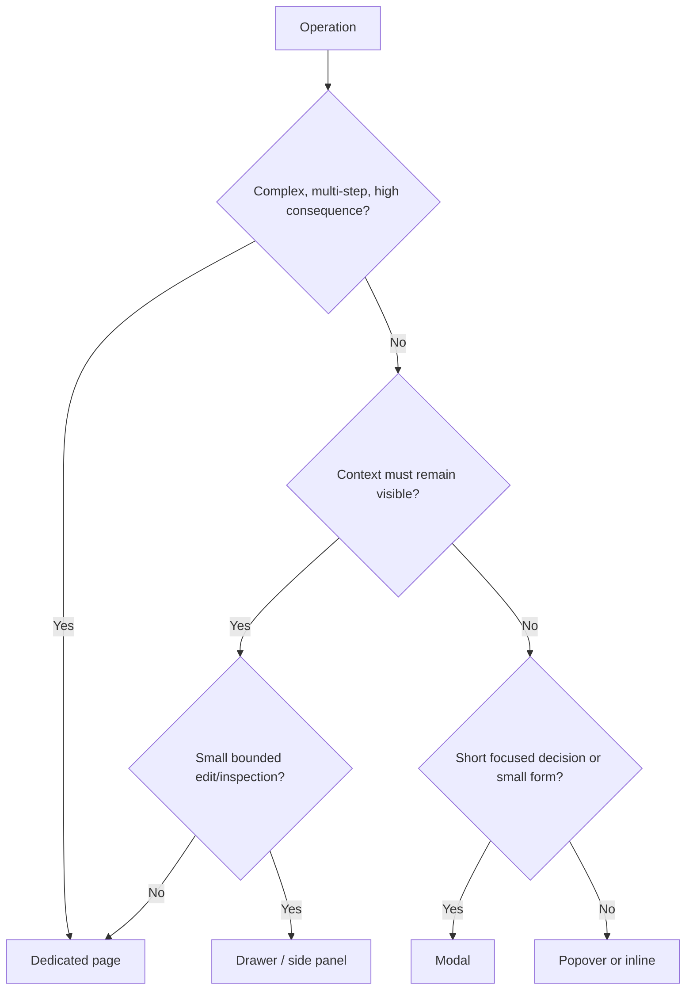
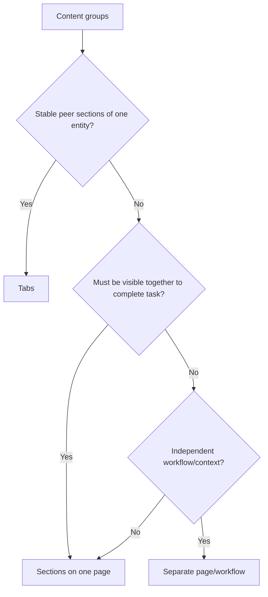
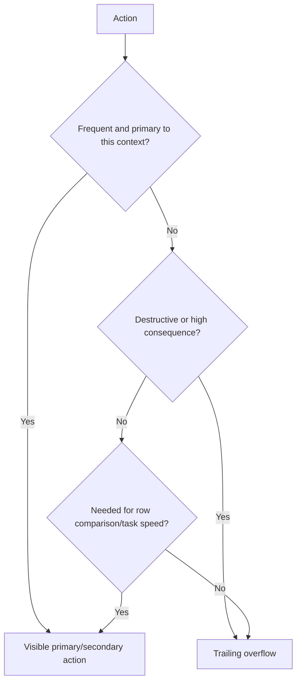
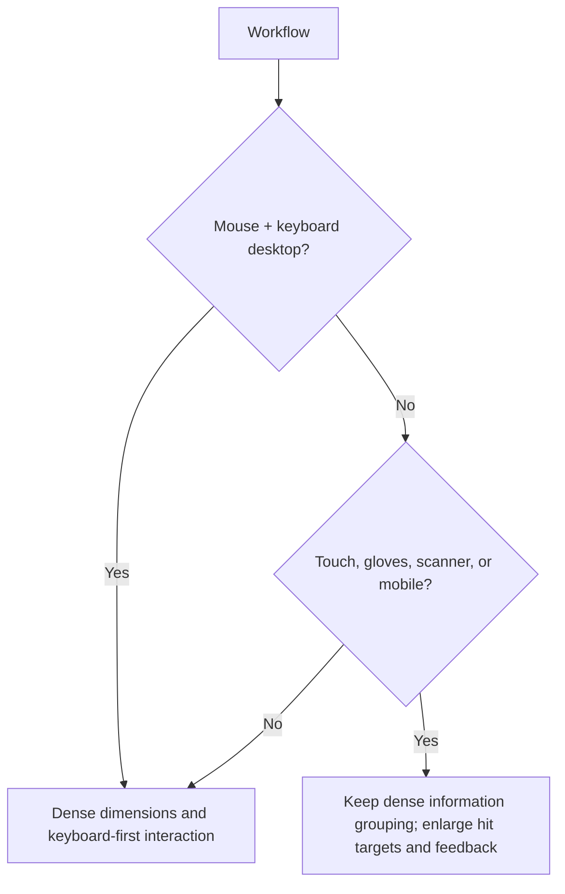
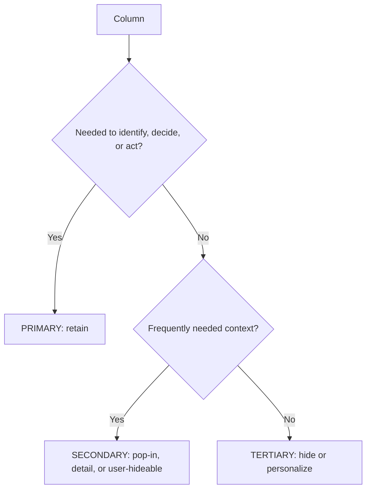
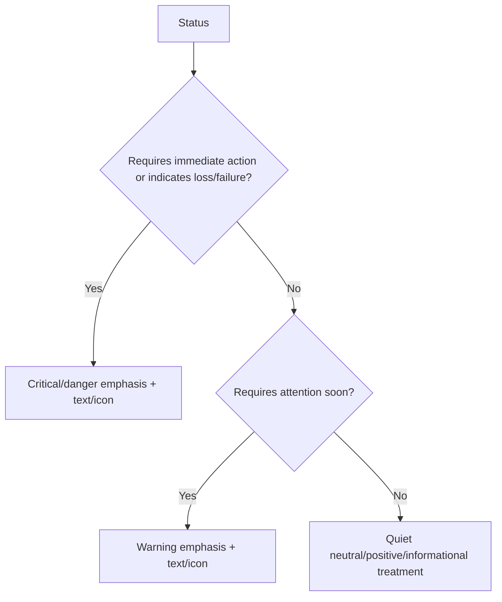
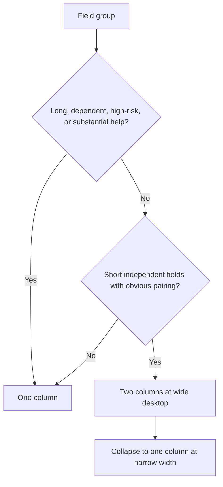

# Dense UI decision trees

These trees encode default decisions. Exceptions must name the workflow constraint.

## Table vs cards vs structured list

## Page vs drawer vs modal vs inline

## Tabs vs sections

## Visible vs overflow action

## Dense desktop vs touch adaptation

## Column priority

## Status emphasis

## One vs two-column form

+

## V3 workflow classification

~~~mermaid
flowchart TD
 A[Requested screen] --> B{Primarily managing records?}
 B -->|Yes| R[Record management: list/form/detail]
 B -->|No| C{Repeatedly processing items through states?}
 C -->|Yes| O[Operational workspace: queue/context/progress/next action]
 C -->|No| D{Committing a consequential business event?}
 D -->|Yes| T[Transactional workflow: context/lines/validation/finalize]
 D -->|No| E{Allocating resources across time/context?}
 E -->|Yes| P[Planning workflow: table/conflicts/detail]
 E -->|No| F{Reviewing evidence or exceptions?}
 F -->|Yes| I[Inspection workflow: table/history/resolve]
 F -->|No| G{Monitoring changing conditions?}
 G -->|Yes| M[Dashboard/exception queue]
 G -->|No| Cfg[Configuration form/workspace]
~~~

## CRUD vs operational workspace

~~~mermaid
flowchart TD
 A[Screen request] --> B{Primary goal is record lifecycle management?}
 B -->|Yes| C[CRUD/list-form-detail]
 B -->|No| D{Repeated processing, state transitions, or physical work?}
 D -->|Yes| W[Operational workspace]
 D -->|No| E{Planning, review, transaction, or monitoring?}
 E -->|Yes| S[Specialized workflow anatomy]
 E -->|No| C
~~~

## Hide vs disable vs read-only

~~~mermaid
flowchart TD
 A[Action or field] --> B{Sensitive or irrelevant here?}
 B -->|Yes| H[Hide]
 B -->|No| C{Value must be inspected but not edited?}
 C -->|Yes| R[Read-only]
 C -->|No| D{Relevant but temporarily unavailable?}
 D -->|Yes| E{Clear way to enable?}
 E -->|Yes| X[Disable with explanation]
 E -->|No| U[Show unavailable reason or hide]
 D -->|No| V[Enable]
~~~

## Confirmation vs immediate action

~~~mermaid
flowchart TD
 A[Mutation] --> B{Destructive, irreversible, broad, external, or authoritative?}
 B -->|Yes| C{Undo/reversal safe and available?}
 C -->|Yes| U[Act then offer undo/reversal]
 C -->|No| Q[Contextual confirmation]
 B -->|No| I[Immediate action with clear result]
~~~

## Inline edit vs form

~~~mermaid
flowchart TD
 A[Edit request] --> B{Frequent, simple, low/moderate consequence?}
 B -->|Yes| C{One value or simple invariant?}
 C -->|Yes| I[Inline edit]
 C -->|No| F[Focused form/drawer/page]
 B -->|No| D{Complex, high-risk, or multi-field invariant?}
 D -->|Yes| F
 D -->|No| I
~~~

## Saved view needed?

~~~mermaid
flowchart TD
 A[List workflow] --> B{Operators repeatedly reconstruct same slice?}
 B -->|Yes| V[Saved views justified]
 B -->|No| C{Shared queue or stable team operating view?}
 C -->|Yes| V
 C -->|No| D[Filters/columns without saved view]
~~~

## History table vs timeline

~~~mermaid
flowchart TD
 A[History] --> B{Need compare/filter/sort actor/time/change?}
 B -->|Yes| T[Dense history table]
 B -->|No| C{Chronological narrative primary?}
 C -->|Yes| L[Timeline/activity feed]
 C -->|No| T
~~~

## Autosave vs explicit save

~~~mermaid
flowchart TD
 A[Edited value] --> B{Low-risk isolated preference?}
 B -->|Yes| A1[Autosave with clear saved state]
 B -->|No| C{Complex, financial, dependent, or review-required?}
 C -->|Yes| S[Explicit Save]
 C -->|No| D[Choose by consequence and user expectation]
~~~

## Wizard vs single form

~~~mermaid
flowchart TD
 A[Form workflow] --> B{Sequence/dependencies make order meaningful?}
 B -->|Yes| C{Uncommon or complex enough to need progress?}
 C -->|Yes| W[Wizard]
 C -->|No| F[Single grouped form]
 B -->|No| F
~~~

## Dashboard vs workspace

~~~mermaid
flowchart TD
 A[Screen goal] --> B{Monitor, summarize, detect exceptions?}
 B -->|Yes| D[Dashboard/exception queue]
 B -->|No| C{Actively process items repeatedly?}
 C -->|Yes| W[Operational workspace]
 C -->|No| D
~~~

## Bulk action confirmation

~~~mermaid
flowchart TD
 A[Selection exists] --> B{Action mutates or deletes records?}
 B -->|No| I[Immediate result with count]
 B -->|Yes| C{Broad, consequential, or irreversible?}
 C -->|Yes| Q[Confirm scope and consequence]
 C -->|No| I
 I --> R[Progress/result + partial failures]
 Q --> R
~~~

## Immediate vs long-running feedback

~~~mermaid
flowchart TD
 A[Operation] --> B{Completes effectively immediately?}
 B -->|Yes| I[Immediate state/result]
 B -->|No| C{Meaningful progress available?}
 C -->|Yes| P[Progress with cancel where safe]
 C -->|No| G[Background status and completion notification]
~~~

## Drawer vs page vs modal

~~~mermaid
flowchart TD
 A[Contextual operation] --> B{Complex, multi-step, or high-consequence?}
 B -->|Yes| P[Dedicated page]
 B -->|No| C{Context should remain visible?}
 C -->|Yes| D{Bounded inspection/edit?}
 D -->|Yes| R[Drawer]
 D -->|No| P
 C -->|No| M[Short modal or inline operation]
~~~

+

## Focus, selection, and active record

~~~mermaid
flowchart TD
 A[Table interaction] --> B{Keyboard target?}
 B -->|Yes| F[Focus-visible: receives keyboard input]
 B -->|No| C{Included in batch?}
 C -->|Yes| S[Selected: part of selection set]
 C -->|No| D{Shown in detail pane?}
 D -->|Yes| O[Active/open record]
 D -->|No| N[Ordinary row]
~~~

## Search mode

~~~mermaid
flowchart TD
 A[Search request] --> B{Across application domains?}
 B -->|Yes| G[Global search]
 B -->|No| C{Identifier/scanner input?}
 C -->|Yes| I[Exact or prefix lookup]
 C -->|No| L[Local list search]
~~~

## Empty state

~~~mermaid
flowchart TD
 A[No results] --> B{No records exist?}
 B -->|Yes| D[Empty dataset: create/import guidance]
 B -->|No| C{Filters active?}
 C -->|Yes| F[Empty filter result: clear/refine filters]
 C -->|No| S[Empty search result: revise query or exact-match hint]
~~~

